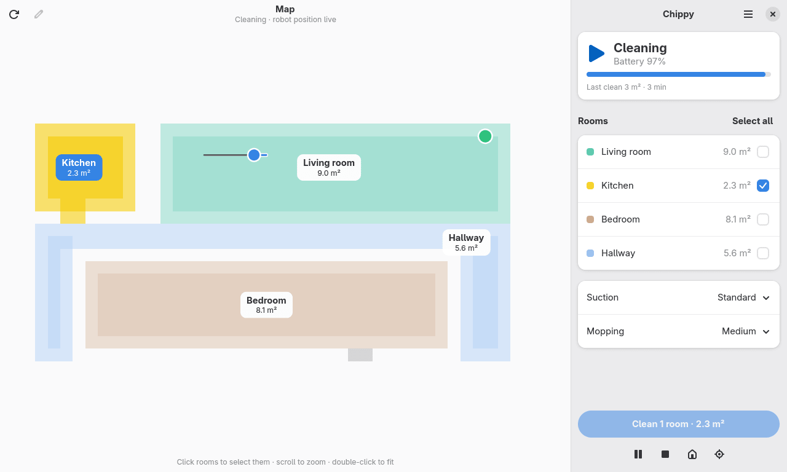
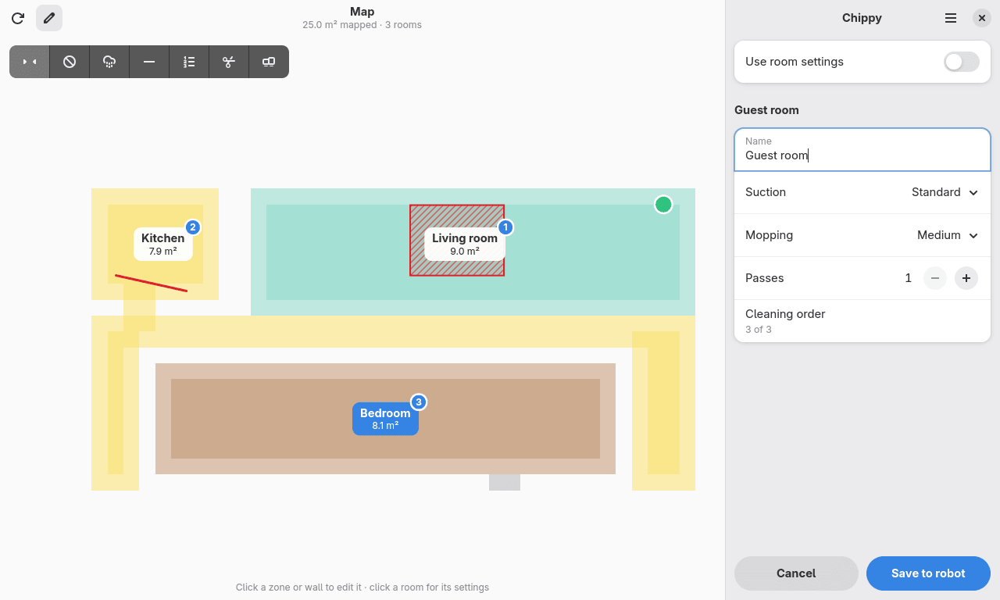
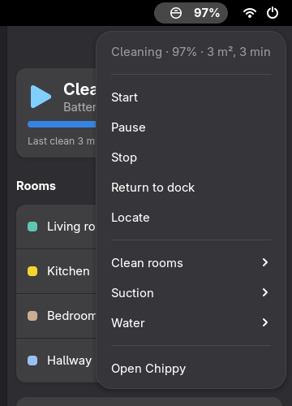

<div align="center">


# Chippy

**Your Dreame robot vacuum, at home on the GNOME desktop.**

A native GTK 4 and libadwaita app for the map, rooms, cleaning runs and map editing,<br>
with an optional GNOME Shell extension for quick controls in the top bar.

[](LICENSE)


[Features](#features) · [Install](#install) · [Signing in](#signing-in) · [Map editing](#map-editing) · [Privacy](#privacy) · [Development](#development)

<br>

<picture>
  <source media="(prefers-color-scheme: dark)" srcset="docs/screenshots/cleaning-dark.png">
  
</picture>

<sub>Screenshots use Chippy's built-in demo flat (<code>--fake</code>), not a real home.</sub>

</div>

## Features

| Feature | What it does |
|---|---|
| 🗺️ **Live map** | Rooms in colour with their areas, the dock, and the robot's position and route while it cleans. |
| 🧹 **Room cleaning** | Pick rooms on the map or in the list, choose suction and mopping, then start, pause, stop, send the robot home or make it play a sound. |
| ✏️ **Map editor** | No-go and no-mop zones, virtual walls, room names, per-room suction, mopping and passes, cleaning order, and room merge and split, all saved to the robot. |
| 🔔 **Background alerts** | Keeps watching after you close the window and tells you when a run finishes or the robot needs help, with readable names for Dreame fault codes. |
| 📌 **Top-bar controls** | An optional GNOME Shell extension shows status and battery and gives one-click start, pause, dock, locate and room cleaning. |
| 🔐 **Private by design** | Sign-in details and the robot token live only in the GNOME Keyring, and commands go straight to the robot on your network. |

<table>
  <tr>
    <td width="66%"></td>
    <td width="34%"></td>
  </tr>
  <tr>
    <td align="center"><sub>Edit mode: zones, walls, cleaning order and per-room settings</sub></td>
    <td align="center"><sub>Quick controls in the top bar</sub></td>
  </tr>
</table>

## Supported robots

| Robot | Status |
|---|---|
| **Dreame r2209** (Xiaomi Robot Vacuum X10) | ✅ Tested, including the map editor |
| Other Dreame vacuums | 🧪 Experimental. Chippy marks them as untested in Preferences; status and controls may work, but the map layout or some states may not. |
| Models with encrypted maps | ⏳ Not supported yet. Status and controls work, but the map can't be shown. |

Robots that someone has shared with your Xiaomi account show up too.

## Install

Download a package for your system from the
[latest release](https://github.com/eboye/chippy-gtk/releases/latest):

| System | File | Install with |
|---|---|---|
| Any distro (Flatpak) | `chippy-…-x86_64.flatpak` / `-aarch64.flatpak` | `flatpak install --user ./chippy-*.flatpak` |
| Debian 13, Ubuntu 26.04 LTS and newer | `chippy_…_amd64.deb` | `sudo apt install ./chippy_*_amd64.deb` |
| Fedora 45 | `chippy-….fedora.x86_64.rpm` | `sudo dnf install ./chippy-*.fedora.x86_64.rpm` |
| openSUSE Tumbleweed | `chippy-….opensuse.x86_64.rpm` | `sudo zypper install --allow-unsigned-rpm ./chippy-*.opensuse.x86_64.rpm` |
| Arch Linux | `chippy-…-x86_64.pkg.tar.zst` | `sudo pacman -U chippy-*-x86_64.pkg.tar.zst` |

The Flatpak needs the GNOME 51 runtime from [Flathub](https://flathub.org/setup), which
Flatpak offers to install with it. The other packages use your system's GTK 4 and libadwaita
(1.6 or newer); each one is installed on the distros above and started by CI before a release
goes out. The packages aren't signed: check them against `SHA256SUMS` from the same release.

### Build the Flatpak yourself

You need `flatpak-builder` and the GNOME 51 runtime and SDK from Flathub:

```bash
flatpak install --user flathub org.gnome.Platform//51 org.gnome.Sdk//51
flatpak-builder --user --install --force-clean build-dir flatpak/io.github.eboye.Chippy.json
flatpak run io.github.eboye.Chippy
```

> [!TIP]
> Chippy keeps running in the background after you close its window. After installing a new
> build, run `flatpak kill io.github.eboye.Chippy` first; otherwise `flatpak run` just brings
> back the old instance.

### From source

Chippy uses the system's PyGObject, GTK 4 and libadwaita, so the virtual environment must see
the system site-packages:

```bash
uv venv --system-site-packages --python /usr/bin/python3
uv sync
tools/run-dev.sh            # add --fake to try it with a demo robot, no account needed
```

## Signing in

Chippy needs your Xiaomi account (the one you use in the Xiaomi Home / Mi Home app) once, to
find your robot and get its token. There are two ways in:

- **Email and password.** Xiaomi may ask for a captcha, which Chippy shows for you to type, or
  email you a code to confirm the sign-in (you can ask for a new one if it expires).
- **QR code, with the Xiaomi Home app.** Use this if your Xiaomi account uses Google, Facebook
  or Apple sign-in. Scan the code with the app, approve, and you're in.

If the account has more than one vacuum, pick yours from the list.

<details>
<summary>Coming from <code>dreamed</code>?</summary>

If you used the older `dreamed` command-line helper, Chippy picks up its saved sign-in from the
keyring and signs you in automatically. Its custom room names are imported too. The `dreamed`
keyring item is only read, never changed or deleted.

</details>

## Map editing

The pencil button above the map switches to edit mode. It isn't available while the robot is
cleaning, returning, paused or offline. A toolbar appears with these tools:

| Tool | What it does |
|---|---|
| **Select** | Click a room to rename it or set its own suction, mopping and passes. Click a zone or wall to move it, resize it or delete it. Drag empty space to pan. |
| **No-go zone** / **No-mop zone** | Drag a rectangle. |
| **Wall** | Drag a line for a virtual wall. |
| **Order** | Click rooms in the order the robot should clean them. |
| **Split** | Click a room, then drag a line across it. |
| **Merge** | Click two neighbouring rooms. |

Zones, walls, names, room settings and order are staged until you press **Save to robot**.
**Cancel** throws them away, after asking if there are changes.

> [!IMPORTANT]
> **Merge** and **Split** are applied to the robot as soon as you confirm them, and **Cancel**
> can't undo them.

Edits change the map stored on the robot, which the phone app shares, so the same rooms and
zones show up there too. The **Use room settings** switch turns the robot's per-room settings
on or off; while it's off, every room is cleaned with the general settings.

## The top-bar extension

**Preferences → General → Show in top bar** installs Chippy's GNOME Shell extension
(`chippy@eboye.github.io`, for GNOME 50 and 51) into `~/.local/share/gnome-shell/extensions`
and enables it. Turning the switch off disables and removes it again. The first time, GNOME
Shell may only pick the extension up after you log out and back in; Chippy tells you when
that's needed.

> [!WARNING]
> **Turn "Show in top bar" off before you uninstall Chippy.** Uninstalling a Flatpak can't run
> any cleanup code, so the extension would stay behind in your home folder. If that already
> happened, remove it with `gnome-extensions uninstall chippy@eboye.github.io`.

## Privacy

- **Secrets stay in the keyring.** The robot's token and your Xiaomi sign-in (email, password
  and session) are stored only in the GNOME Keyring, as the item "Chippy robot vacuum". They are
  never written to files or logs.
- **Commands stay local.** Status, controls and map edits go directly to the robot on your
  network.
- **The Xiaomi cloud is used only where it's needed:** signing in, finding your robots,
  downloading the map, and following the robot's position and room settings, which the robot
  only publishes there.

## Development

```bash
uv run pytest -q                                   # Python tests
uv run ruff check src tests && uv run ruff format --check src tests
npm ci && npm run lint                             # ESLint for the Shell extension
tools/run-dev.sh --fake                            # the app with a demo robot and an in-memory keyring
tools/nested-check.sh --scenario main              # app + extension in an isolated headless GNOME Shell
```

- `--fake` runs Chippy against a simulated robot under a separate application id, with
  temporary config and cache folders and an in-memory keyring, so it never touches your real
  setup.
- `tools/nested-check.sh` starts a private, headless GNOME Shell with its own D-Bus session and
  dconf database. It drives the app window and the top-bar menu with real (virtual) pointer and
  keyboard input, and writes screenshots and results to `/tmp/chippy-nest/out`. Scenarios:
  `main`, `signin`, `qr` and `edit`.

### Releases

[`.github/workflows/release.yml`](.github/workflows/release.yml) runs the tests, builds the
Flatpak (x86_64 and aarch64) and the deb, rpm and pacman packages, installs each package in a
fresh container of every distro it's for and starts Chippy there with the demo robot. Pushing
a version tag also publishes everything as a GitHub release:

1. Set the new version in `src/chippy/__init__.py` and `pyproject.toml`, and add a
   `<release>` entry to `data/io.github.eboye.Chippy.metainfo.xml`
   (`packaging/build.py check-version` checks they agree).
2. Commit, then tag and push: `git tag v0.2.0 && git push origin main v0.2.0`.

To build and test without releasing, run the workflow by hand from the Actions tab.
`packaging/build.py` and `packaging/install-test.sh` do the same locally (see their headers).

<details>
<summary>Project layout and Flatpak dependencies</summary>

| Path | Contents |
|---|---|
| `src/chippy/` | The app: `core/` talks to the robot and the Xiaomi cloud, `ui/` holds the GTK interface |
| `extension/` | The GNOME Shell extension |
| `data/` | Desktop file, AppStream metadata, D-Bus service and icons |
| `flatpak/` | The Flatpak manifest and generated Python dependencies |
| `tests/` | The pytest suite |
| `tools/` | Dev runner and the nested GNOME Shell check |
| `packaging/` | deb, rpm and pacman builds (nfpm) and the install and smoke tests |
| `.github/workflows/` | The release workflow |

`flatpak/python-deps.json` is generated with
[flatpak-pip-generator](https://github.com/flatpak/flatpak-builder-tools/tree/master/pip):

```bash
flatpak-pip-generator.py --runtime org.gnome.Sdk//51 --prefer-wheels cryptography,zeroconf \
  python-miio==0.5.12 micloud==0.6 secretstorage requests hatchling -o flatpak/python-deps
```

</details>

## License

Chippy is free software, licensed under the [GPL-3.0-or-later](LICENSE).

<sub>Chippy is an independent project and is not affiliated with, endorsed by or sponsored by
Dreame or Xiaomi. Product names are trademarks of their respective owners.</sub>
