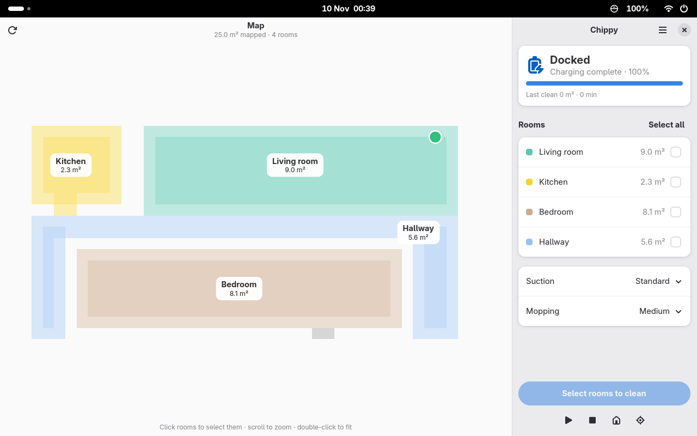

# Chippy

Chippy is a GNOME app (GTK 4 and libadwaita) for Dreame robot vacuums. It shows the robot's
map with its rooms, lets you pick rooms to clean, start, pause or stop a run and send the robot
back to its dock, and it can keep watching in the background to notify you when a run finishes
or the robot needs help. An optional GNOME Shell extension puts the robot's status and quick
controls in the top bar.



*The screenshot uses Chippy's built-in demo flat (`--fake`), not a real home.*

## Supported robots

- **Dreame r2209 (Xiaomi Robot Vacuum X10)**: tested.
- **Other Dreame vacuums**: experimental. Chippy marks them as untested in Preferences; status
  and controls may work, but the map layout or some states may not.
- **Encrypted maps** (used by some newer models) are not supported yet; Chippy says the map
  can't be shown, but status and controls still work.

## Install

### Flatpak (recommended)

You need `flatpak-builder` and the GNOME 51 runtime and SDK from Flathub:

```bash
flatpak install --user flathub org.gnome.Platform//51 org.gnome.Sdk//51
flatpak-builder --user --install --force-clean build-dir flatpak/io.github.eboye.Chippy.json
flatpak run io.github.eboye.Chippy
```

### From source

Chippy uses the system's PyGObject, GTK 4 and libadwaita, so the virtual environment must see
the system site-packages:

```bash
uv venv --system-site-packages --python /usr/bin/python3
uv sync
tools/run-dev.sh            # add --fake to try it with a demo robot, no account needed
```

## First run: signing in

Chippy talks to the robot over your local network, but it needs a token from your Xiaomi
account (the one used by the Xiaomi Home / Mi Home app) to do so.

- **Signed in to Xiaomi with Google?** Xiaomi's API needs a real Xiaomi password. Set one in
  your Xiaomi account settings first, then sign in to Chippy with your email and that password.
- **Captcha:** Xiaomi sometimes asks for one; Chippy shows the image and you type the
  characters.
- **Email code:** if Xiaomi wants to verify the sign-in, it emails you a code. Enter it in
  Chippy (you can ask for a new code if it expires).
- **Already using `dreamed`?** If you set up the `dreamed` command-line tool before, Chippy
  picks up its saved sign-in from the keyring and signs you in automatically. Your custom room
  names from `dreamed` are imported too.

After signing in, choose your vacuum if the account has more than one.

## The top-bar switch

**Preferences → General → Show in top bar** installs Chippy's GNOME Shell extension
(`chippy@eboye.github.io`) into `~/.local/share/gnome-shell/extensions` and enables it. Turning
the switch off disables and removes it again. The first time, GNOME Shell may only pick the
extension up after you log out and back in; Chippy tells you when that's needed.

> **Turn "Show in top bar" off before you uninstall Chippy.** Uninstalling a Flatpak can't run
> any cleanup code, so the extension would stay behind in your home folder. If that already
> happened, remove it with
> `gnome-extensions uninstall chippy@eboye.github.io`.

## Privacy

- The robot's token and your Xiaomi sign-in (email, password and session) are stored only in
  the GNOME Keyring, as the item "Chippy robot vacuum", never in files. They are never logged.
- An existing `dreamed` keyring item is only read and copied, never changed or deleted.
- Room names you set are stored locally in Chippy's config folder and never uploaded.
- Chippy contacts the Xiaomi cloud only to sign in and to download the map; robot status and
  commands go directly to the robot on your network.

## Development

```bash
uv run pytest -q                                   # Python tests
uv run ruff check src tests && uv run ruff format --check src tests
npm ci && npm run lint                             # ESLint for the Shell extension
tools/run-dev.sh --fake                            # the app with a demo robot and an in-memory keyring
tools/nested-check.sh --scenario main              # app + extension in an isolated headless GNOME Shell
```

`--fake` runs Chippy against a simulated robot under a separate application id, with temporary
config and cache folders and an in-memory keyring, so it never touches your real setup.
`tools/nested-check.sh` starts a private, headless GNOME Shell with its own D-Bus session and
dconf database, drives the app window and the top-bar indicator with real (virtual) pointer and
keyboard input, and writes screenshots and results to `/tmp/chippy-nest/out`.

The desktop files and icons are in `data/`, the Flatpak manifest in `flatpak/`.
`flatpak/python-deps.json` is generated with
[flatpak-pip-generator](https://github.com/flatpak/flatpak-builder-tools/tree/master/pip):

```bash
flatpak-pip-generator.py --runtime org.gnome.Sdk//51 --prefer-wheels cryptography,zeroconf \
  python-miio==0.5.12 micloud==0.6 secretstorage requests hatchling -o flatpak/python-deps
```

## License

GPL-3.0-or-later. See [LICENSE](LICENSE).
