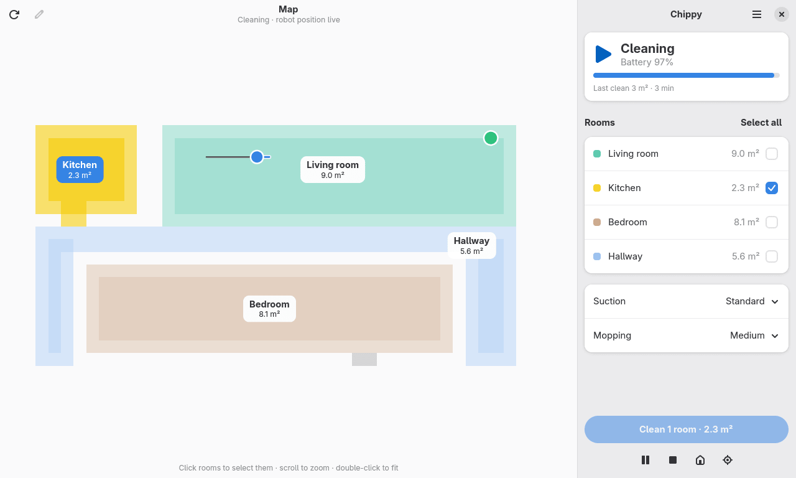

<!-- Template for the GitHub release notes, filled in by `packaging/build.py release-notes`.
     $version is the version, $highlights the release's description from the metainfo file.
     GitHub adds the list of merged changes below it. Keep each paragraph on one line: release
     notes render every line break. -->

  

## What's new in Chippy $version

$highlights

## Download

| Your system | File | Install with |
|---|---|---|
| Any distro, via Flatpak | `chippy-$version-x86_64.flatpak` (ARM: `-aarch64`) | `flatpak install --user ./chippy-$version-x86_64.flatpak` |
| Debian 13, Ubuntu 26.04 LTS and newer | `chippy_$version-1_amd64.deb` | `sudo apt install ./chippy_$version-1_amd64.deb` |
| Fedora 45 | `chippy-$version-1.fedora.x86_64.rpm` | `sudo dnf install ./chippy-$version-1.fedora.x86_64.rpm` |
| openSUSE Tumbleweed | `chippy-$version-1.opensuse.x86_64.rpm` | `sudo zypper install --allow-unsigned-rpm ./chippy-$version-1.opensuse.x86_64.rpm` |
| Arch Linux | `chippy-$version-1-x86_64.pkg.tar.zst` | `sudo pacman -U chippy-$version-1-x86_64.pkg.tar.zst` |

- **Flatpak** works on any distro with Flatpak. It needs the GNOME 51 runtime from [Flathub](https://flathub.org/setup), which Flatpak offers to install along with it.
- **The other packages** use your system's GTK 4 and libadwaita (1.6 or newer). Before this release went out, each one was installed on the distros above and started with a demo robot.
- **Checksums:** the packages aren't signed. Check your download with `sha256sum -c --ignore-missing SHA256SUMS`.

## Getting started

Open Chippy and sign in with the Xiaomi account you use in the Xiaomi Home app. If that account signs in with Google, Facebook or Apple, choose **Sign in with the Xiaomi Home app** and scan the QR code.

Chippy is tested with the **Dreame r2209 (Xiaomi Robot Vacuum X10)**; other Dreame vacuums are experimental. The [README](https://github.com/eboye/chippy-gtk#readme) covers the map editor, the top-bar extension and privacy.
